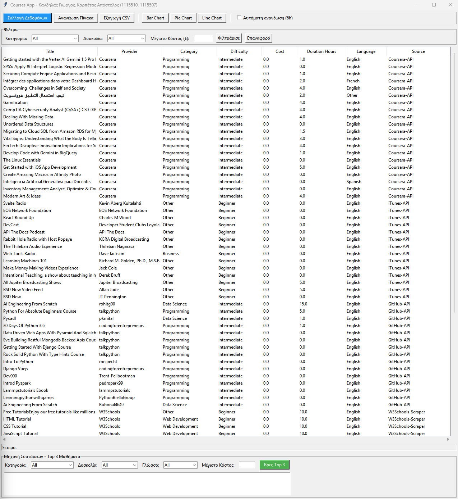
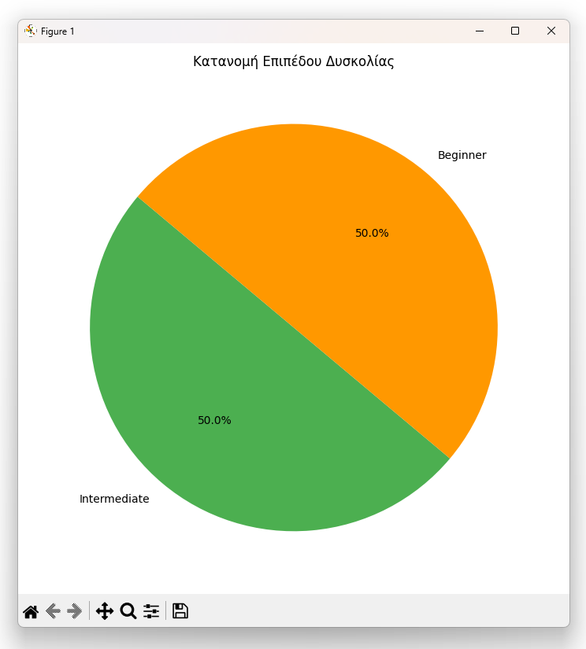

# Compilers Coursework

This repository contains two compiler-related coursework projects:

- [`FlexBison/`](FlexBison/) — three incremental versions of a SQL lexer/parser
  implemented with Flex and Bison.
- [`Python/`](Python/) — a Tkinter desktop application that collects, stores,
  filters, visualizes, and recommends online courses.

The repository also includes the reports and screenshots associated with the
assignments.

## Demo

### SQL compiler (version 3)

Given this input:

```sql
CREATE TABLE suppliers (supplier_id INT, company VARCHAR(60));
CREATE TABLE parts (part_id INT, description VARCHAR(100), supplier_id INT);

SELECT suppliers.company
FROM suppliers
JOIN nonexistent ON suppliers.supplier_id = nonexistent.supplier_id;

SELECT parts.description
FROM parts
JOIN suppliers ON parts.supplier_id = suppliers.missing_col;
```

the parser accepts the syntax and the semantic checks catch both mistakes:

```text
$ make && ./myParser tests/test_join_invalid.sql
Semantic error: unknown table 'nonexistent'.
Semantic error: unknown table 'nonexistent'.
Semantic error: column 'missing_col' not found in table 'suppliers'.
Syntactic analysis successful.
```

Type checking works on `WHERE ... IN (...)`, comparisons, `GROUP BY` and `ORDER BY`:

```text
$ ./myParser tests/test_new_checks_invalid.sql
Semantic error: type mismatch in IN list — column 'items.item_id' is INT, but literal is VARCHAR.
Semantic error: type mismatch in IN list — column 'items.name' is VARCHAR, but literal is INT.
Semantic error: column 'nonexistent_col' not found in any active table.
Semantic error: column 'fake_col' not found in any active table.
Semantic error: type mismatch — column 'items.item_id' is INT, but literal is FLOAT.
Syntactic analysis successful.
```

(Abridged: the real output repeats an error once for each offending literal.)

### Course recommendation app

| Main window: collected courses, filters and the top-3 recommender | Difficulty chart |
| --- | --- |
|  |  |

The interface is in Greek: *Συλλογή Δεδομένων* collects data, *Ανανέωση Πίνακα* reloads the
table, *Εξαγωγή CSV* exports, and *Βρες Top 3* finds the three best courses for the chosen
filters.

## FlexBison: SQL compiler

The [`FlexBison/FlexBison/`](FlexBison/FlexBison/) directory contains three
versions of the same SQL compiler:

| Version | Main additions |
| --- | --- |
| `1` | Lexical and syntactic analysis for `CREATE TABLE` and `SELECT` statements |
| `2` | Semantic checks, including table/column validation and type checks |
| `3` | SQL joins, table aliases, ambiguous-column checks, and the checks from version 2 |

Each version contains:

- `lexer.l` — Flex lexer definition
- `parser.y` — Bison grammar and semantic-analysis code
- generated C/header files (`lex.yy.c`, `parser.tab.c`, and related headers)
- `Makefile` — rebuilds the generated sources and compiler executable
- `tests/` — valid and invalid SQL examples, plus screenshots of expected output

### Prerequisites

Install the following tools:

- GCC
- GNU Make
- Flex
- Bison
- the Flex runtime library (`libfl-dev` on Debian/Ubuntu)

On Debian/Ubuntu, the dependencies can be installed with:

```bash
sudo apt install build-essential flex bison libfl-dev
```

### Build and run

Build one version from its own directory:

```bash
cd FlexBison/FlexBison/3
make
```

The Makefile creates an executable named `myParser`. Run it by passing an SQL
file:

```bash
./myParser tests/test_select_valid.sql
./myParser tests/test_select_invalid.sql
```

To build another version, replace `3` with `1` or `2`. The invalid examples
are intended to demonstrate syntax or semantic diagnostics; the valid examples
should finish with a successful-analysis message. To remove generated build
outputs:

```bash
make clean
```

The checked-in generated C files are provided as coursework artifacts; running `make` is the reproducible way to
regenerate and build the parser from `lexer.l` and `parser.y`.

## Python: course recommendation application

The main application is in [`Python/`](Python/). It is a Tkinter GUI that:

- collects course data from public APIs and web sources, with built-in fallback
  data when a source is unavailable;
- stores and deduplicates courses in `courses_1115510.csv`;
- filters courses by category, difficulty, and maximum cost;
- displays bar, pie, and line charts;
- recommends the top three courses using duration and cost;
- optionally refreshes the data every six hours;
- exports the currently stored data to another CSV file.

Important modules include:

- `main.py` — GUI entry point
- `collectors.py` — course collection and normalization of external data
- `storage.py` — CSV loading, saving, deduplication, and export
- `recommender.py` — top-three recommendation logic
- `charts.py` — chart windows
- `scheduler.py` — optional automatic refresh
- `config.py` — application settings and CSV schema
- `requirements.txt` — Python dependencies

The nested directory
[`Python/1115510_1115507/Python/`](Python/1115510_1115507/Python/) contains
an alternate/earlier submitted copy of the application, with its own source
files, report, screenshots, requirements file, and CSV data. For normal use,
run the top-level `Python/` copy; the nested copy is retained as a separate
coursework artifact.

### Prerequisites

- Python 3
- Tkinter
- the packages listed in `Python/requirements.txt`
- network access for live collection (the application can use fallback data when
  an external source cannot be reached)

On Debian/Ubuntu, install Tkinter and the Python dependencies as follows:

```bash
sudo apt install python3-tk
cd Python
python3 -m venv .venv
source .venv/bin/activate
python -m pip install -r requirements.txt
```

### Run

From the top-level `Python/` directory:

```bash
python main.py
```

The application initially loads the local `courses_1115510.csv` file. Use
**Syllogi Dedomenon** in the toolbar to collect fresh data, **Ananeosi
Pinaka** to reload the CSV, and the chart, filter, recommendation, and export
controls to work with the stored courses. The CSV path is relative to the
current working directory, so run the application from `Python/` as shown
above.

To run the alternate submitted copy instead:

```bash
cd Python/1115510_1115507/Python
python3 -m venv .venv
source .venv/bin/activate
python -m pip install -r requirements.txt
python main.py
```

## Reports and artifacts

- `FlexBison/REPORT_Flex_Bison.pdf` — Flex/Bison assignment report
- `Python/REPORT_Python_bw.pdf` — Python assignment report
- `Python/1115510_1115507/Python/REPORT_Python_bw.pdf` — report for the nested submission
- `tests/` and `Screenshots/` directories — sample inputs and captured results

